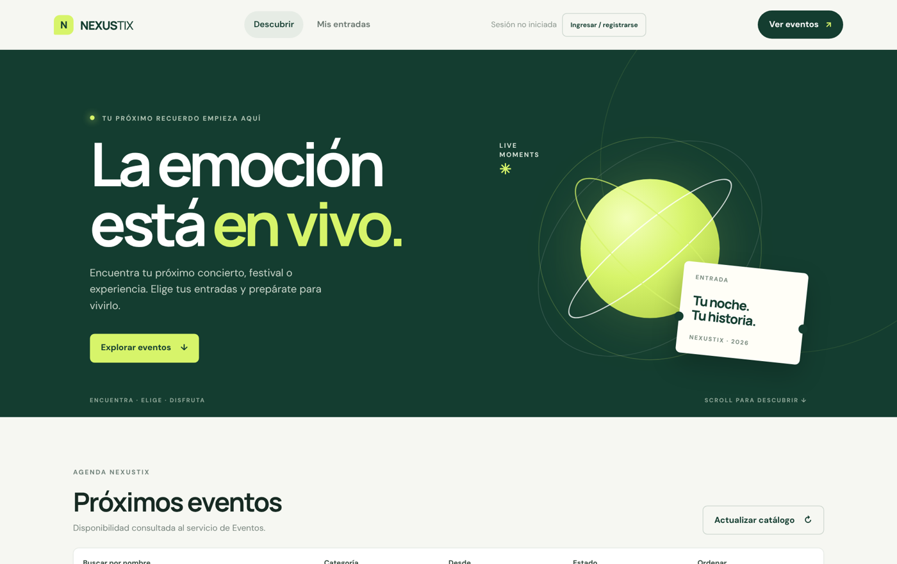
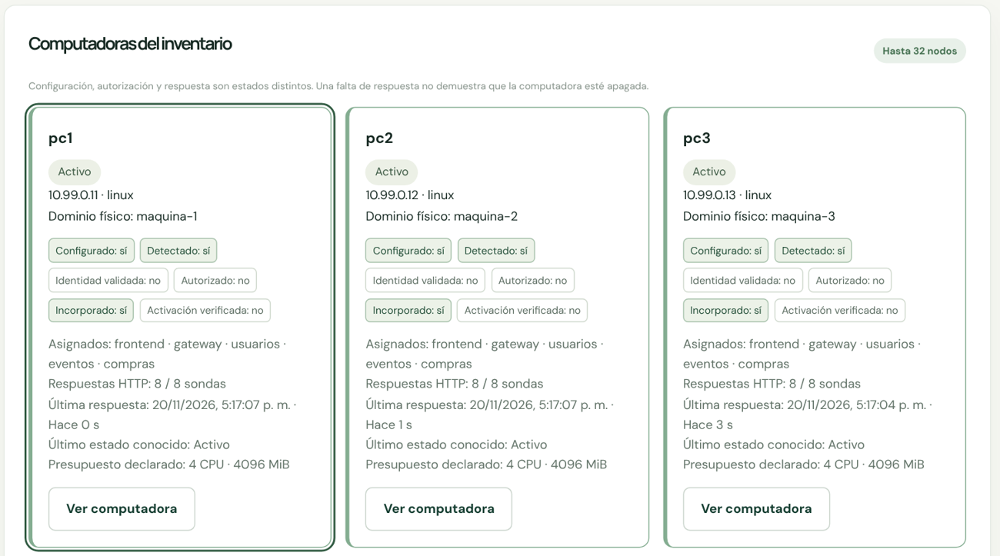
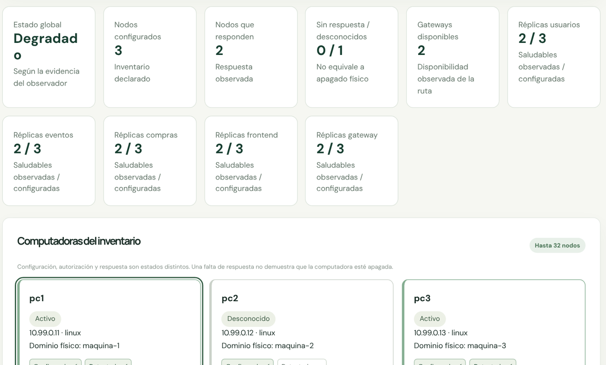
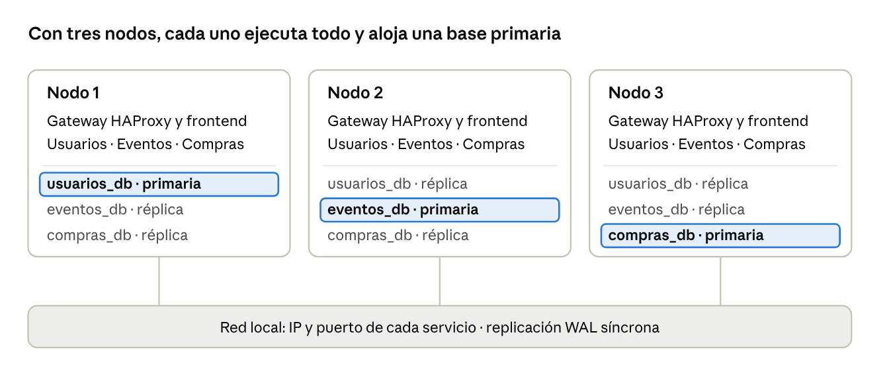

# NEXUSTIX

**Sistema distribuido de venta de entradas con replicación, tolerancia a fallas y seguridad.**

NEXUSTIX es una tienda web de entradas para eventos que funciona repartida en
varias computadoras. Vende sin sobreventa aunque muchas personas compren a la
vez, sigue atendiendo si se apaga cualquiera de sus nodos sin perder compras
confirmadas y protege el acceso con autenticación multifactor.

Proyecto final del curso **Sistemas Operativos II** · Escuela de Informática ·
Universidad Nacional de Trujillo (2026).



## Características

- **Tres microservicios** (Usuarios, Eventos, Compras) en FastAPI, cada uno con su base PostgreSQL.
- **Despliegue en varias computadoras** heterogéneas (Linux y Windows con WSL2) unidas por Tailscale, generado desde un único inventario.
- **Failover automático de bases de datos** con Patroni y etcd: si cae un nodo, la réplica síncrona se promueve por mayoría de votos, sin perder datos (RPO 0).
- **Coordinación distribuida**: servicio de nombres con latidos, elección de coordinador (Bully), relojes de Cristian, Berkeley, Lamport y vectoriales.
- **Consistencia**: exclusión mutua sobre el inventario, transacciones Saga con compensaciones e idempotencia.
- **Seguridad**: Argon2id, JWT RS256, control de acceso por roles, MFA con TOTP, bloqueo ante fuerza bruta y entradas QR de un solo uso.
- **Panel de administración** con el estado del clúster, procesos, réplicas, coordinación y un laboratorio de resiliencia.

| Centro de Control | Caída de un nodo |
|---|---|
|  |  |

## Resultados

| Prueba | Resultado |
|---|---|
| 45 compradores simultáneos por 6 asientos (3 nodos) | 6 ventas exactas, inventario consistente |
| Apagar de golpe cualquier nodo | Vuelve a vender en 28–51 s sin intervención |
| Compras confirmadas perdidas | 0 |
| Partición de red | Nunca hay dos bases principales |
| Pruebas automáticas | 123 en verde (`python -m pytest`) |

Detalle en [docs/RESULTADOS_ALTA_DISPONIBILIDAD.md](docs/RESULTADOS_ALTA_DISPONIBILIDAD.md).

## Arquitectura



Cada nodo ejecuta el frontend (Nginx), un gateway (HAProxy), los tres servicios,
una copia de cada base (PostgreSQL + Patroni) y un votante etcd. Cada base tiene
su copia principal en un nodo distinto. Ver [docs/ARQUITECTURA.md](docs/ARQUITECTURA.md)
y la relación con los temas del curso en [docs/CONCEPTOS.md](docs/CONCEPTOS.md).

**Tecnologías:** Python 3.11 · FastAPI · SQLAlchemy · Alembic · PostgreSQL 15 ·
Patroni · etcd · HAProxy · Nginx · Docker Compose · Tailscale · JavaScript.

## Inicio rápido

Requisitos: Docker con Compose v2 y Python 3.10 o superior.

### En una sola computadora

```bash
git clone https://github.com/haroldrs/NEXUSTIX.git && cd NEXUSTIX
```

```bash
python3 scripts/nx.py demo secretos
```

```bash
python3 scripts/nx.py demo up
```

```bash
python3 scripts/nx.py demo admin --email admin@example.com
```

Abrir `http://localhost:8080`. La contraseña del administrador queda en
`~/.config/nexustix/demo-secrets/admin-password`. Para detener sin borrar datos:
`python3 scripts/nx.py demo stop`.

### En varias computadoras (alta disponibilidad)

1. Instalar Docker y Tailscale en cada computadora (en Windows, Docker Desktop con WSL2).
2. En la computadora administradora, copiar un inventario de ejemplo y poner las IP:

```bash
cp despliegue-nodos/examples/7-tres-pc-patroni.yml ~/inventario.yml
```

3. Generar las imágenes y la configuración de cada nodo:

```bash
python3 scripts/paquete_offline.py crear --salida ~/nexustix-imagenes.tar
```

```bash
python3 despliegue-nodos/nodos.py preparar ~/inventario.yml ~/nexustix-entrega --imagenes-offline
```

4. Copiar a cada nodo su carpeta y el paquete de imágenes, y encenderlo:

```bash
bash despliegue-nodos/unir.sh iniciar ~/nexustix-entrega/pc1 --admin-email admin@example.com
```

Guía completa (Tailscale, firewall, orden de arranque y solución de problemas):
[despliegue-nodos/ALTA_DISPONIBILIDAD.md](despliegue-nodos/ALTA_DISPONIBILIDAD.md).

## Estructura del repositorio

| Ruta | Contenido |
|---|---|
| `usuarios/`, `eventos/`, `compras/` | Microservicios: API, modelos, migraciones y Dockerfile |
| `shared/` | Código común: autenticación, Saga, coordinación distribuida, diagnóstico y observación del clúster |
| `frontend/` | Aplicación web: tienda, entradas, control de acceso y panel de administración |
| `despliegue-nodos/` | Despliegue en varias computadoras: inventarios, generador, Patroni y `unir.sh` |
| `docker-compose*.yml`, `compras_lb/`, `postgres/` | Despliegue en una sola computadora |
| `despliegue-externo/` | Plantillas para publicar con HTTPS |
| `scripts/` | Operación (`nx.py`), secretos, paquete de imágenes, respaldos y prueba de concurrencia |
| `tests/` | Pruebas automáticas y de infraestructura ([docs/PRUEBAS.md](docs/PRUEBAS.md)) |
| `docs/` | Arquitectura, conceptos, pruebas y resultados |

## Pruebas

```bash
pip install -r requirements-test.txt
```

```bash
python -m pytest
```

No requieren Docker ni bases reales. Las pruebas con infraestructura están en
[docs/PRUEBAS.md](docs/PRUEBAS.md).

## Seguridad

Ningún secreto está en el repositorio: las claves se generan al instalar y se
entregan a los contenedores como secretos de Docker. No publique la carpeta
`master/` de una entrega ni los paquetes `.tgz` de los nodos.

## Autores

- Kevin Cotrina Villoslada
- Angel Jery Medina Ninaquispe
- Harold Ruiz Sánchez

Docente: Ing. Celestino Medardo Quispe Varón.
