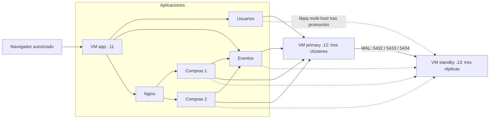

# NEXUSTIX en tres máquinas virtuales

**Preparación validada; VMs no desplegadas.** Línea base funcional:
[03/11/2026](../docs/RESULTADOS_DISTRIBUIDO.md), conservada sin cambios. Esta fase
no reimplementa el checkout ni altera demo, staging o laboratorio. La evidencia
nueva está en [RESULTADOS.md](RESULTADOS.md).

## Diagnóstico de partida

Los tres Compose existentes separaban correctamente aplicaciones de bases y
usaban secretos libpq multi-host. No dependían del DNS Docker entre VMs.
Faltaban instalador, configuración por rol, comprobaciones del nodo ejecutor,
pruebas de conmutación entre hosts y automatización de promoción/reintegración.
El standby carecía de volumen y configuración de archivado WAL al promoverse.
Las imágenes usaban el mismo prefijo del laboratorio, aunque los volúmenes eran
separados. La reintegración exigía editar manualmente el Compose.

Se conserva la aplicación. Los cambios están en esta carpeta y el generador de
manifiestos, que admite `--only-vm` sin escribir el Compose del laboratorio.
Las imágenes VM usan `nexustix-vm/*`; el entrypoint VM conserva copias parciales
con `pg_basebackup --no-clean` y rechaza datos marcados como aislados.

## Topología y requisitos

| VM / rol físico | IPv4 privada editable | Recursos iniciales | Servicios y puertos publicados |
|---|---|---|---|
| app | 192.168.56.11 | 4 vCPU, 4 GiB RAM, 25 GiB | Frontend 8080; Usuarios 8001; Eventos 8002; Compras 8003/8004; Nginx 8005 |
| primary | 192.168.56.12 | 2 vCPU, 3 GiB RAM, 40 GiB | Usuarios DB 5432, Eventos DB 5433, Compras DB 5434 |
| standby | 192.168.56.13 | 2 vCPU, 3 GiB RAM, 40 GiB | Réplicas de las tres bases, mismos puertos |

Son capacidades iniciales de demostración, no un dimensionamiento medido.
Reservar memoria adicional para Fedora anfitrión y contenedores existentes;
no iniciar las VMs si ello compromete laboratorio/staging. Discos de bases
necesitan espacio adicional para WAL, slots, backups y generaciones conservadas.

Fedora mantenido con DNF5, reloj sincronizado, Python 3, Docker Engine con
Compose v2 >= 2.20 y acceso administrativo dentro de cada invitado. NAT para
instalar dependencias; segunda interfaz privada host-only (sin gateway por
defecto). La creación de esa red en VirtualBox requiere autorización separada
si modifica el host. No se ha ejecutado en esta fase.



Los nombres `eventos`, `compras1`, `compras2` son DNS internos del Compose app.
Las bases se conectan mediante IP privadas explícitas: no se necesita editar
`/etc/hosts`. DNS externo puede añadirse después, con resolución comprobada
desde los contenedores; el preparador actual acepta únicamente IPv4 privadas.

## Variables, secretos y persistencia

| Variable / recurso | Uso |
|---|---|
| `VM_ROLE` | `app`, `primary`, `standby`; `rejoin` es modo de la antigua VM primary, no una cuarta VM |
| `VM_APP_HOST`, `VM_PRIMARY_HOST`, `VM_STANDBY_HOST` | IP físicas estables; no intercambiar sus valores después de promover |
| `VM_BIND_IP` | IP local correspondiente al rol; nunca 0.0.0.0 |
| `VM_REJOIN_GENERATION` | `r1`, `r2`…; volúmenes nuevos para cada intento de reintegración |
| `NEXUSTIX_DISTRIBUTED_SECRETS_DIR` | Ruta absoluta de secretos del rol; por defecto `/etc/nexustix-vm/secrets` |
| `*_database_url` | Dos candidatos, `target_session_attrs=read-write`, `connect_timeout=3` por host |
| `EVENTOS_URL` | `http://eventos:8002` dentro de app |
| `NEXUSTIX_PG_UPSTREAM_HOST/PORT`, `NEXUSTIX_PG_SLOT` | Origen y slot de clonación por base, resueltos por Compose |
| `nexustix-vm-{app,primary,standby,rejoin}` | Proyectos Docker exclusivos |
| `nexustix-vm-primary_*`, `nexustix-vm-standby_*` | Volúmenes de datos y WAL; ninguno es externo ni compartido con los entornos existentes |
| `nexustix-vm-rejoin_<generación>_*` | Nuevos datos y WAL de reintegración; se conservan todos los anteriores |

Usuarios en app recibe la clave privada JWT; el resto recibe solo lo requerido
por su manifiesto. Las VMs de bases reciben contraseñas de bases y replicación,
nunca la clave JWT ni contraseñas administrativas de la web. Pagos siguen siendo
simulados. HTTP/SCRAM en red privada de demostración: TLS pendiente.

## Orden reproducible de ejecución

Los comandos de los pasos 3–8 se ejecutarán **dentro de las VMs**, no ahora en el
Fedora anfitrión. Los scripts operativos muestran un plan salvo `--apply`.
Rechazan equipos sin virtualización reconocida, IP equivocada, Docker remoto
o un daemon con proyectos demo/staging/laboratorio. No son una barrera frente
a un operador root que invoque Docker directamente.

### 1. Preparar artefactos en Fedora (sin red ni Docker)

```bash
.venv/bin/python despliegue-vm/scripts/preparar.py /ruta/NUEVA/paquete-vm \
  --app 192.168.56.11 --primary 192.168.56.12 --standby 192.168.56.13
python3 despliegue-vm/scripts/empaquetar.py /ruta/NUEVA/nexustix-vm.tar.gz
```

Guardar el SHA256 impreso del artefacto. `preparar.py` requiere PyYAML (incluido
en el venv); `empaquetar.py` usa solo biblioteca estándar y excluye secretos,
resultados y venv. Conservar `master/` fuera de las VMs como respaldo privado.
Copiar por SSH/SCP verificado el código y **solo** la carpeta del rol a cada VM.
Verificar `sha256sum nexustix-vm.tar.gz` antes de extraer. No compartir directorios
con los secretos del laboratorio. No sobrescribir una instalación previa.

### 2. Preparar las VMs y transferir archivos

Crear las tres VMs e identificar la MAC del segundo adaptador en VirtualBox.
Configurar desde consola o transferir por el acceso de administración ya
establecido. Con el paquete de código en cada invitado:

```bash
# Dentro de una VM NUEVA, con /opt/nexustix y /etc/nexustix-vm aún inexistentes:
sudo test ! -e /opt/nexustix
sudo tar -xzf nexustix-vm.tar.gz -C /opt
sudo test ! -e /etc/nexustix-vm
# "rol" es la carpeta app, primary o standby recibida por canal seguro:
sudo cp -a rol /etc/nexustix-vm
sudo chmod 700 /etc/nexustix-vm /etc/nexustix-vm/secrets
cd /opt/nexustix
```

Los `test` son precondiciones: si fallan, detener el procedimiento y revisar;
no continuar con la copia. Para reintegración se copia después únicamente
`rejoin/config.env` como `/etc/nexustix-vm/rejoin.env`, conservando los secretos
ya presentes de la antigua VM primary.

### 3. Configurar interfaz privada e instalar dependencias

```bash
# Primero revisar el plan, con la interfaz/MAC reales del segundo adaptador:
sudo python3 despliegue-vm/scripts/configurar_red.py \
  --env-file /etc/nexustix-vm/config.env --interface enp0s8 --expected-mac MAC_REAL
# Solo dentro del invitado y después de revisar, repetir con --apply.
sudo python3 despliegue-vm/scripts/instalar.py --env-file /etc/nexustix-vm/config.env
# Revisar el plan y repetir con --apply dentro del invitado.
```

La configuración no modifica la interfaz de ruta por defecto ni perfiles
existentes distintos. El instalador no elimina paquetes incompatibles ni
actualiza/reinicia un Docker CE existente: lo informa y conserva. Comprobar
`docker compose version`, `timedatectl` y `chronyc tracking` en cada VM. Activar
Docker puede crear reglas de forwarding **del invitado**; véase [RED.md](RED.md).

Con SELinux enforcing, etiquetar únicamente los secretos de esta instalación
nueva, sin desactivar SELinux:

```bash
sudo semanage fcontext -a -t container_file_t '/etc/nexustix-vm/secrets(/.*)?'
sudo restorecon -RFv /etc/nexustix-vm/secrets
```

Si la regla ya existe, inspeccionarla antes de repetir. Nunca reetiquetar
carpetas de otros entornos. El instalador no lo hace silenciosamente.

### 4. Validar manifiesto y controles de acceso

```bash
sudo python3 despliegue-vm/scripts/vm.py --env-file /etc/nexustix-vm/config.env validate
sudo python3 despliegue-vm/scripts/firewall.py \
  --env-file /etc/nexustix-vm/config.env --admin-ip 192.168.56.1
```

`validate` solo acredita configuración y archivos de secretos; no un servidor
operativo. Revisar el plan de firewall y aplicar únicamente en la VM autorizada
con `--apply`, antes de publicar servicios. [RED.md](RED.md) describe backend,
persistencia pendiente y comprobaciones. No cambiar la red/firewall del host.

### 5. Arrancar primary, después standby

En cada VM, en ese orden:

```bash
sudo python3 despliegue-vm/scripts/vm.py --env-file /etc/nexustix-vm/config.env deploy
# Revisado el plan:
sudo python3 despliegue-vm/scripts/vm.py --env-file /etc/nexustix-vm/config.env deploy --apply
sudo python3 despliegue-vm/scripts/vm.py --env-file /etc/nexustix-vm/config.env diagnose
```

En primary cada base debe mostrar recovery=false y un standby streaming; en
standby recovery=true y receiver streaming desde .12 en el puerto correspondiente.
Durante el arranque inicial de primary la lista de réplicas estará vacía hasta
arrancar standby. El init crea slots `usuarios_db_replica`, `eventos_db_replica`,
`compras_db_replica`. No se vuelve a ejecutar sobre bases existentes.

Las clones fallidas quedan bloqueadas por marcador persistente; no limpiar
volúmenes para reintentar. Conservarlos y preparar nombres de volumen nuevos.
WAL usa `archive_mode=on` en ambos roles; el standby empieza a archivar como
primario al promoverse. No equivale a archivar continuamente el WAL recibido
mientras sigue en recuperación (`archive_mode=always` no se activó).

### 6. Arrancar app y crear administrador

Repetir `deploy --apply` y `diagnose` en VM app. Las cuatro instancias API deben
conectar a una base escribible. Crear la primera cuenta administrativa:

```bash
sudo docker compose --env-file /etc/nexustix-vm/config.env \
  -f despliegue-vm/compose.app.yml exec -T usuarios python bootstrap_admin.py \
  --email vm-admin@example.com --password-file /run/secrets/admin_password --if-missing
```

Portal: `http://192.168.56.11:8080`; contraseña en el archivo privado del rol app,
no en esta guía. Registrar compradores desde la web.

### 7. Comprobar distribución y aceptación

Desde VM app, con rutas nuevas para evidencia:

```bash
sudo python3 despliegue-vm/scripts/verificar.py --env-file /etc/nexustix-vm/config.env \
  --expected-primary primary --output /tmp/vm-conexiones-iniciales.json
sudo python3 despliegue-vm/scripts/aceptacion.py --env-file /etc/nexustix-vm/config.env \
  --stage before --expected-primary primary --state /tmp/vm-compra.json \
  --output /tmp/vm-antes.json --apply
```

`verificar` prueba autenticación PostgreSQL desde cada contenedor API hacia ambos
hosts. `aceptacion` añade un evento y una compra sintéticos; guarda IDs y claves,
nunca JWT, contraseña ni QR. No usar una cuenta con más de 500 entradas para
esta comprobación (el endpoint de entradas está limitado a 500).

### 8. Fallos, recuperación y apagado

Seguir [FALLOS.md](FALLOS.md) para caída de VM, red, fencing, promoción y
reintegración. [RECUPERACION.md](RECUPERACION.md) conserva backup/PITR.
Para apagar ordenadamente: `vm.py … stop --apply` en app, luego bases; con
replicación síncrona apagar primary antes de standby para evitar commits en
espera. `start --apply` reanuda el mismo proyecto; no usar `down -v`, prune,
reset-datos ni los scripts HA ligados a staging.

## Límites

Una sola VM app es un punto único de fallo. Tres VMs sobre el mismo equipo no
toleran caída del equipo, energía o disco compartido. Replicación asíncrona
admite pérdida de WAL; las tres bases no constituyen un snapshot global.
`target_session_attrs=read-write` selecciona un escribible pero no evita
split-brain: el fencing es obligatorio. No hay failover automático ni quorum.

Para una fase posterior: otra VM app/entrada redundante, dominios físicos
independientes y, si procede, tres miembros de consenso con Patroni/etcd y
fencing verificable. Un cuarto monitor aislado no completa esa arquitectura.
Versiones base de imágenes/dependencias siguen las etiquetas del proyecto;
conservar el artefacto y registrar los digests construidos antes de comparar
resultados entre máquinas. Este paquete no promete builds binarios idénticos
entre fechas distintas.
