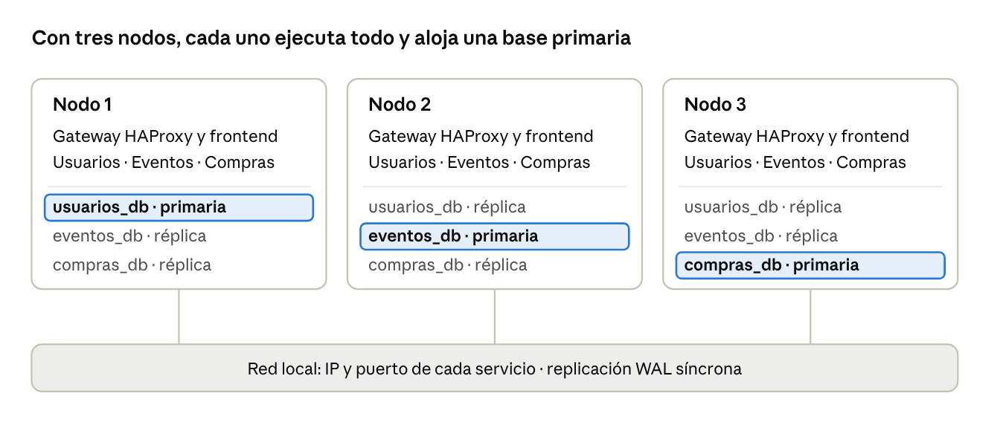

# Arquitectura

NEXUSTIX es una tienda de entradas formada por tres microservicios que se
ejecutan replicados en varias computadoras. Este documento describe cómo se
organizan y cómo se comunican.

## Componentes de cada nodo

Cada computadora ejecuta los mismos diez contenedores:

| Contenedor | Tecnología | Función |
|---|---|---|
| `frontend` | Nginx | Sirve la aplicación web (tienda, entradas, control de acceso y panel) |
| `gateway` | HAProxy | Entrada pública: reparte las solicitudes entre las copias sanas de cada servicio en todos los nodos |
| `router` | HAProxy | Enrutamiento interno entre servicios de distintos nodos |
| `usuarios` | FastAPI | Cuentas, inicio de sesión (Argon2id + JWT RS256), roles, MFA (TOTP) y bloqueo por intentos |
| `eventos` | FastAPI | Catálogo, zonas, asientos e inventario con exclusión mutua |
| `compras` | FastAPI | Pedidos (Saga + idempotencia), pago simulado, entradas QR, reembolsos y observación del clúster |
| `usuarios_db`, `eventos_db`, `compras_db` | PostgreSQL 15 + Patroni | Una copia de cada base; Patroni supervisa y promueve |
| `etcd` | etcd 3.5 | Votante del consenso (Raft) que decide qué copia de cada base es la principal |

Cada servicio es dueño de su base: ninguno accede a la base de otro. Si Compras
necesita apartar asientos, se lo pide a Eventos por su API.

## Comunicación

| Interacción | Mecanismo |
|---|---|
| Navegador → servicios | HTTP/JSON a través del gateway del nodo |
| Compras → Eventos (reservar, confirmar, liberar) | RPC sobre REST, síncrona, con tiempo máximo, reintentos idempotentes y cortacircuito |
| Avisos que no pudieron entregarse | Outbox: se guardan en la base y se reintentan (asíncrona) |
| Instancia → instancias | Latido cada 2 s a todas (comunicación en grupo) |
| Base principal → réplicas | Replicación física por WAL (una réplica síncrona y una asíncrona) |
| Votantes etcd | Protocolo Raft |
| Entre computadoras | Túneles WireGuard de Tailscale (red privada cifrada) |

Cada mensaje entre servicios lleva el reloj de Lamport y el reloj vectorial del
emisor en la cabecera `X-Nexustix-Reloj`.

## Coordinación distribuida (`shared/coordination.py`)

- **Servicio de nombres:** directorio replicado. Cada instancia se registra y
  late cada 2 s; sin latido en 6 s (T + Δ) es sospechosa y a los 15 s, caída.
  Las resoluciones se guardan 5 s (TTL).
- **Elección Bully:** gana la instancia viva de mayor prioridad
  (`(n.º de nodos − índice) × 10 + rango del servicio`).
- **Relojes físicos:** Cristian contra el coordinador y Berkeley (ajuste lógico,
  sin cambiar la hora del sistema operativo).
- **Relojes lógicos:** Lamport y vectorial propagados en la Saga.

## Compra de extremo a extremo

1. Compras registra el pedido con su clave de idempotencia.
2. Pide a Eventos reservar: Eventos bloquea la fila del evento (`SELECT … FOR UPDATE`),
   verifica disponibilidad y descuenta.
3. Se registra el pago simulado y se confirma la reserva.
4. Se emiten las entradas con un código QR aleatorio de un solo uso.
5. Si un paso falla, la Saga ejecuta compensaciones (liberar asientos). Un trabajo
   de recuperación retoma los pedidos interrumpidos.

Invariante del inventario: `inicial = disponibles + reservadas + vendidas`.

## Replicación y tolerancia a fallas

Cada base tiene tres copias, una por nodo. Solo la **principal** acepta
escrituras; la **réplica síncrona** confirma cada transacción antes de que se dé
por hecha y la **asíncrona** aporta una tercera copia.

La principal mantiene una llave de líder en etcd (30 s, renovada cada 10 s con
el voto de la mayoría). Si su nodo se apaga, la llave vence y los dos nodos
restantes (2 de 3 votos) permiten que Patroni promueva la réplica síncrona. Los
servicios se conectan con una URL de varios hosts y `target_session_attrs=read-write`,
así que siguen solos a la nueva principal. Al volver, `pg_rewind` reincorpora el
nodo como réplica.

Un nodo aislado por una partición de red tiene 1 de 3 votos: no puede renovar la
llave y pasa a solo lectura. Nunca hay dos principales (se elige consistencia, CP).

## Despliegue

- **Varias computadoras:** `despliegue-nodos/` genera, desde un inventario YAML,
  la configuración de cada nodo (Compose, secretos, Patroni, etcd, HAProxy) y
  `unir.sh` la enciende en orden. Ver [ALTA_DISPONIBILIDAD.md](../despliegue-nodos/ALTA_DISPONIBILIDAD.md).
- **Una computadora:** `docker-compose.yml` levanta todo en una sola máquina para
  desarrollo y demostración (`python3 scripts/nx.py demo up`).
