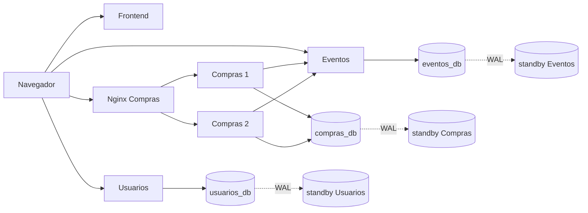

# Arquitectura y límites de distribución

La línea base es el [resultado real del 03/11/2026](RESULTADOS_DISTRIBUIDO.md).
No se han reimplementado sus funcionalidades. La organización de Git no altera
APIs, migraciones, imágenes ni Compose de los entornos existentes.

| Componente | Estado y dependencia real |
|---|---|
| Usuarios | FastAPI; identidades, Argon2id, JWT RS256 y refresh; `usuarios_db`; firma privada solo en sus instancias |
| Eventos | FastAPI; catálogo, asientos, reservas, compensaciones, invariantes; `eventos_db`; verifica JWT y credencial interna |
| Compras | FastAPI; compras, pedidos, pagos simulados, saga, outbox, QR y recuperación; `compras_db` compartida + HTTP hacia Eventos |
| Nginx Compras | Dos backends dentro del Docker local; failover pasivo; `/lb-health` solo prueba Nginx |
| Frontend | HTML/JS/CSS servido por Nginx; el navegador llama a URLs de `frontend-config.js`/`config.js` |
| PostgreSQL | Tres dominios, cada uno en un clúster PostgreSQL 15; laboratorio añade un standby por clúster |

Es un diagrama lógico del laboratorio, no una afirmación de despliegue entre PC.
Las réplicas API de un mismo dominio deben usar la misma base lógica, claves y
política de autenticación. No se deben clonar datos para cada réplica API. La
idempotencia se persiste en PostgreSQL, no depende de afinidad de sesión en Nginx.
Los JWT se verifican localmente; Compras no necesita llamar Usuarios por compra.
Las sesiones refresh de Usuarios también deben compartir base y claves.

Las migraciones Alembic de Usuarios/Compras arrancan bajo bloqueo asesor;
Eventos hace su inicialización aditiva con protección. Levantar servicios puede
escribir datos aunque el objetivo aparente sea comprobar salud. Por eso en esta
fase solo se valida configuración, nunca se arrancan APIs existentes.

Los nombres `compras1`, `compras2`, `eventos` y el resolver `127.0.0.11` de
`compras_lb/nginx.conf` pertenecen al Docker local. Una red bridge ni una red
`external` de Compose conectan automáticamente hosts diferentes. Para tres PC
se necesitan direcciones LAN/puertos publicados y upstreams configurados para
esos endpoints. [Redes Compose](https://docs.docker.com/compose/how-tos/networking/).

`DATABASE_URL_FILE` permite URLs multihost; `shared/db_engine.py` selecciona
`target_session_attrs=read-write`, descarta conexiones inválidas con
`pool_pre_ping` y limita la conexión con `DB_CONNECT_TIMEOUT_SECONDS` (5 s por
defecto). Esto no promueve un standby, no conserva transacciones en vuelo y no
resuelve split-brain: si hay dos primarios escribibles, el cliente no puede
identificar cuál es el autorizado. Primero fencing, después promoción.

El streaming preparado es asíncrono: puede perder transacciones no replicadas.
Además son tres clústeres independientes; promoverlos no es una operación atómica
entre dominios y puede dejar referencias cruzadas que requieran reconciliación.
[Streaming PostgreSQL 15](https://www.postgresql.org/docs/15/warm-standby.html).
La saga compensa fallos contemplados; no convierte tres bases en una transacción
ACID distribuida. PITR requiere backups y WAL disponibles fuera del host perdido.

El Nginx actual solo habilita reenvío de POST ya enviados para `/compras` bajo
idempotencia. No extender esa política automáticamente a login, refresh, pagos
o QR. Para `/ordenes`, un cliente debe repetir la misma intención con la misma
clave y verificar el resultado; una reconexión de pool no repite una transacción.

VMs: [preparación](../despliegue-vm/RESULTADOS.md). PC físicas:
[plan pendiente](PLAN_DESPLIEGUE_3_PC.md). Ambos diseños tienen componentes únicos
sin continuidad automática de extremo a extremo; ver [LIMITACIONES.md](LIMITACIONES.md).
