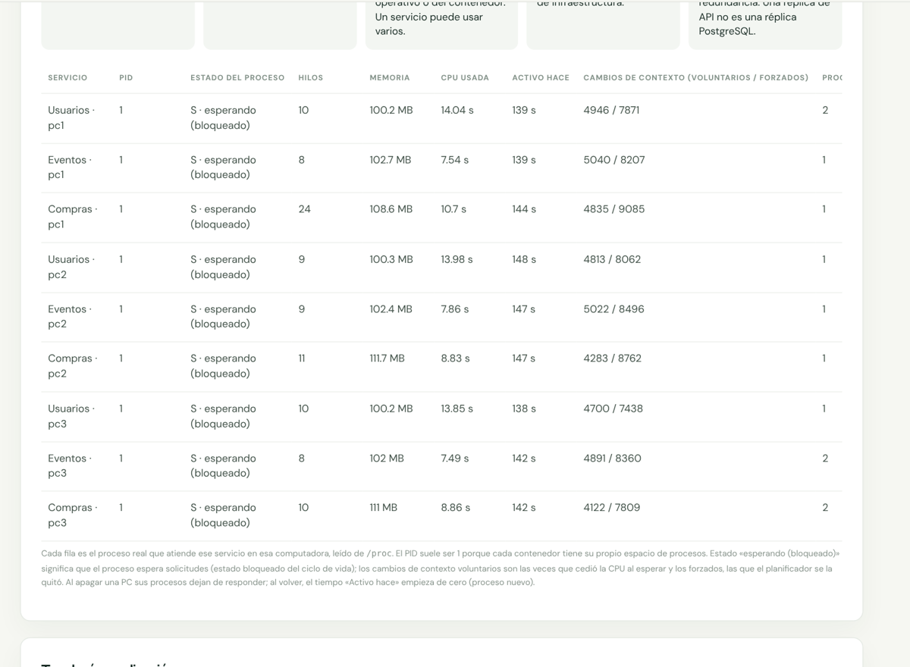
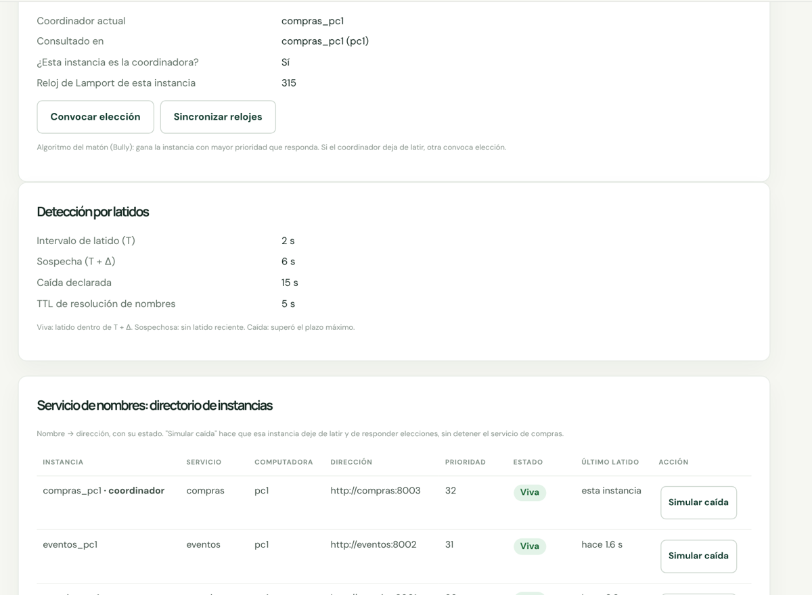

# Conceptos de sistemas distribuidos en NEXUSTIX

Relación entre los temas del curso Sistemas Operativos II y dónde se implementan
y se observan en el sistema. El panel de administración incluye esta misma
relación en **Panel académico**.

## Unidad I · Introducción, procesos y comunicación

| Concepto | Implementación | Dónde se observa |
|---|---|---|
| Sistema distribuido, transparencia, heterogeneidad | Tres nodos (Fedora y Windows con WSL2) atienden la misma tienda | La tienda desde la IP de cualquier nodo |
| Microservicios y arquitectura multinivel | Usuarios, Eventos y Compras, cada uno con su base | `usuarios/`, `eventos/`, `compras/` |
| Procesos (PID, estado, hilos, planificador) | Datos de `/proc` de cada servicio (`shared/process_info.py`) | Centro de Control → Procesos |
| Señales | `docker compose stop` (SIGTERM) y `kill` (SIGKILL) | Terminal del nodo |
| Sockets, RPC sobre REST | HTTP/JSON sobre TCP; Compras invoca a Eventos | Observabilidad → recorrido del pedido |
| Comunicación asíncrona | Outbox de avisos pendientes | `shared/checkout.py` |
| Comunicación en grupo | Latidos a todas las instancias | Coordinación distribuida |
| Balanceo | HAProxy con comprobaciones de salud | Centro de Control |

## Unidad II · Nombres, sincronización, consistencia, replicación y tolerancia a fallas

| Concepto | Implementación | Dónde se observa |
|---|---|---|
| Servicio de nombres, latidos, T + Δ, TTL | Directorio replicado en `shared/coordination.py` | Coordinación distribuida |
| Elección de líder | Algoritmo del matón (Bully) | Coordinación distribuida → Simular caída |
| Relojes físicos | Cristian y Berkeley | Coordinación distribuida → Sincronizar relojes |
| Relojes lógicos | Lamport y vectorial en cada mensaje de la Saga | Recorrido del pedido; comparación de sucesos |
| Exclusión mutua, condición de carrera | `SELECT … FOR UPDATE` sobre el evento | Consistencia y snapshots |
| Transacciones distribuidas | Saga con compensaciones e idempotencia (en lugar de 2PC) | Recorrido del pedido |
| Replicación pasiva y activa | Bases primario-respaldo; servicios activos en todos los nodos | PostgreSQL y persistencia |
| Modelos de consistencia y CAP | Fuerte en la principal y la réplica síncrona; eventual en la asíncrona; CP ante particiones | Consistencia y snapshots |
| Consenso y quórum | etcd (Raft), mayoría 2 de 3 | Monitor de principales |
| Detección y recuperación | Llave de líder con TTL, Patroni, `pg_rewind`, trabajo de recuperación de pedidos | Centro de Control, Historial de incidentes |

## Unidad III · Seguridad, modelos de implantación y casos de estudio

| Concepto | Implementación | Dónde se observa |
|---|---|---|
| Autenticación | Argon2id y JWT RS256 de 10 minutos con renovación rotativa | Inicio de sesión |
| Autenticación multifactor | TOTP (RFC 6238) con código QR y códigos de un solo uso | Usuarios y roles → Mi verificación en dos pasos |
| Fuerza bruta | Bloqueo de 120 s tras 5 intentos; contador en la base replicada | Usuarios y roles |
| Control de acceso | Roles comprador, organizador y administrador verificados en el servidor | Panel de administración |
| Reenvío (replay) | Códigos TOTP, claves de idempotencia y entradas QR de un solo uso | Control de acceso |
| Protección de comunicaciones | WireGuard (Tailscale) entre nodos y firewall limitado a esa red | Despliegue |
| Gestión de secretos | Claves generadas al instalar, montadas como secretos de Docker | `scripts/generar_secretos.py`, `despliegue-nodos/` |
| Modelos de implantación | Clúster local (on-premises) heterogéneo | Despliegue en tres PC |
| Casos de estudio | Comparación con GFS, Dynamo, Spanner, Kafka y Netflix | Panel académico → Casos de estudio |

## Alternativas no implementadas

| Tema | Decisión |
|---|---|
| Elección en anillo | Bully converge más rápido con pocas instancias |
| Exclusión mutua distribuida o por ficha | La centralizada en la base principal basta; si cae, el consenso elige otra |
| Compromiso en dos fases | Bloquea si cae el coordinador; se eligió Saga |
| Publicación/suscripción (Kafka) | Con tres servicios bastan HTTP y outbox |
| Tolerancia bizantina | Requiere 3k + 1 nodos y firmas; se toleran fallas por caída y temporización |
| HTTPS en el navegador y TLS interno | Plantillas en `despliegue-externo/`; propuesta de mejora |
