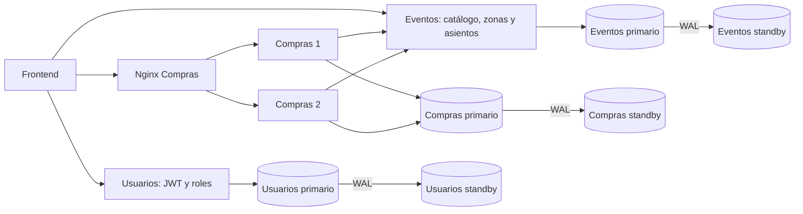
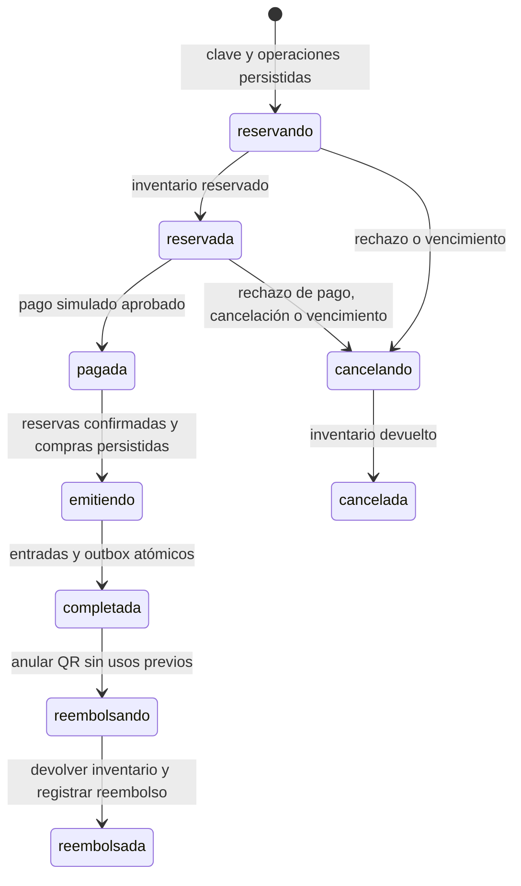

# Evolución distribuida — 2 de noviembre de 2026

## Auditoría previa

Se inspeccionaron servicios, modelos, migraciones, Compose, frontend, scripts,
pruebas y documentación vigente. No existe `despliegue-vm/` ni un repositorio
Git utilizable en esta copia. Respaldo previo del código:
`/tmp/nexustix-codigo-antes-distribuido-20261102.tar.gz`, SHA256
`51a536a9cff1d904fa421ca29e76932bf15285f3a1f40cba1996fa74cede08f3`.

| Funcionalidad inicial | Clasificación | Evidencia / carencia |
|---|---|---|
| Autenticación, autorización, idempotencia individual | Implementada y validada localmente | 102 pruebas Python iniciales aprobadas en Fedora |
| Reservas, compensación y recuperación | Implementada; validación distribuida real pendiente | Pruebas SQLite/dobles; integración PostgreSQL disponible |
| Replicación, promoción y respaldo lógico | Implementada; validación del despliegue real pendiente | Scripts existentes, no se ejecutaron contra datos actuales |
| Compra grupal | Parcial | No conserva identificadores ante reinicio |
| Pagos, QR, acceso, reembolsos, organizadores | Pendiente | No existen en el código inicial |
| Catálogo administrable, asientos, expiración | Pendiente | Solo catálogo sembrado y stock general |
| Outbox, PITR, archivos VM | Pendiente | No existen |

Docker reportó 13 contenedores saludables del proyecto `nexustix-auth-staging`,
incluidas réplicas ausentes en los Compose de esta copia. El código local y
ese despliegue no deben considerarse idénticos. No se reconstruirán, detendrán,
migrarán ni reiniciarán esos contenedores o sus volúmenes.

## Plan y límites operativos

1. Conservar contratos anteriores; agregar pedidos persistentes para el nuevo
   checkout, reutilizando inventario y compras existentes.
2. Incorporar pago simulado, emisión y acceso en Compras: misma transacción
   para pago/estado local/outbox; Saga para la comunicación con Eventos.
3. Validar sobre PostgreSQL local desechable y puertos nuevos.
4. Preparar laboratorio Compose independiente y topología VM parametrizada.
5. Probar respaldo físico/WAL y registrar evidencias, limitaciones y pendientes.

No ejecutar configuraciones de red ni despliegues VM. No intervenir los
volúmenes existentes. Las pruebas de caída de VM se mantienen PENDIENTES.

## Implementación entregada (3 de noviembre de 2026)

| Fase | Cambios / archivos principales | Validación y alcance |
|---|---|---|
| 1, auditoría | Este informe y copia previa de código | 102 pruebas Python iniciales; inventario Docker solo lectura |
| 2, flujo | `shared/catalog.py`, `shared/checkout.py`, modelos de Eventos/Compras, roles de Usuarios, `frontend/checkout.js` | Checkout HTTP conectado a datos, no maqueta |
| 3, consistencia | Pedidos con bloqueo de fila, pagos únicos, entradas únicas por unidad, outbox/notificaciones, operaciones cerradas | Concurrencia, replay, expiración, rechazo, reembolso, validación duplicada y recuperación en PostgreSQL |
| 4, replicación | `scripts/generar_topologia.py`, `docker-compose.distribuido.yml`, init y entrypoint PostgreSQL | Tres standbys Docker con streaming; promoción/reintegración en clústeres locales efímeros |
| 5, recuperación | `scripts/physical_backup.py`, `postgres/archive-wal.sh`, `tests/postgres/test_pitr.py` | Backup verificado y PITR real a punto nombrado en directorio nuevo |
| 6, VMs | `despliegue-vm/compose.{app,primary,standby}.yml`, configuración y guías | `docker compose config --quiet` aprobado; no se arrancó ninguna VM ni se configuró su red |
| 7, fallos | `scripts/verificar_distribuido.py`, `tests/postgres/test_checkout.py` | Caída de Compras1 y recuperación tras reinicio reales en laboratorio; caída de VM pendiente |
| 8, interfaz/evidencia | Portal, gestión de eventos, pedidos/pagos, QR, acceso, diagnóstico DB y documentación | Sintaxis JS, autenticación Node y portal renderizado en Firefox; interacción completa en navegador pendiente |

### Arquitectura y responsabilidad



Pagos son **simulados**, sin tarjetas. Se mantienen dentro de Compras junto
con emisión y control de acceso para confirmar pago y estado local en una
transacción. No se agregó un servicio remoto de pago ficticio. Eventos sigue
siendo la única autoridad del inventario. Cambiar hosts solo requiere secretos
`DATABASE_URL_FILE`, `EVENTOS_URL` y configuración pública del frontend.

### Flujo durable del pedido



- `POST /ordenes` acepta 1–20 ítems y hasta 200 entradas por pedido. La clave
  identifica una intención completa: mismo usuario/cuerpo ⇒ misma orden;
  otro cuerpo/usuario ⇒ 409. Operaciones `ord-<orden>-<ítem>` se guardan antes
  de contactar Eventos. `/compras` y `/compras/grupal` conservan sus contratos
  anteriores; la idempotencia grupal nueva corresponde a `/ordenes`.
- Reservas duran 600 s por defecto (`ORDER_TTL_SECONDS`). Solo el coordinador
  propietario de la fila decide vencer, pagar o compensar; Eventos no vence
  unilateralmente una reserva que pueda tener pago confirmado. Durante una
  caída, la liberación puede retrasarse hasta la recuperación.
- Dos réplicas toman `FOR UPDATE` sobre la misma orden; el pago tiene PK por
  orden y las entradas restricción única `(orden_id,item,numero)`. La aprobación
  simulada y el paso a `pagada` se confirman juntos. No hay cobros externos.
- El worker corre cada 5 s, retoma estados persistidos y usa el mismo protocolo
  que HTTP. Confirmación remota ambigua conserva el pedido para reintento;
  emisión fallida no vuelve a cobrar. Outbox y transición se confirman juntos;
  notificaciones internas deduplican por ID de evento. Entrega al menos una vez,
  efecto idempotente en el buzón; no se implementaron correos.
- Reembolso bloquea la orden, rechaza entradas usadas y anula QR **antes** de
  devolver inventario. Los fallos intermedios quedan en `reembolsando`.
- La validación del QR bloquea la misma orden y consume la entrada una vez.
  QR es un secreto aleatorio de 256 bits, se transmite en el cuerpo, no en URLs.
  El organizador requiere permiso sobre el evento; administrador puede validar.
- Cada asiento tiene código único por evento, zona y precio. El precio se
  obtiene de Eventos y se fija en la reserva; el cliente no decide el importe.
  El catálogo inicial heredado conserva precio cero: definir eventos nuevos
  con precios antes de una demostración comercial.
- Correlation ID por petición, identificador de instancia y logs JSON sin
  cuerpos/query strings. Las operaciones remotas nuevas tienen timeout,
  tres intentos con backoff y circuit breaker local por proceso. Los eventos
  outbox tienen secuencia persistente; el Lamport legacy sigue siendo didáctico.

### Invariantes y límites de consistencia

`stock_inicial = stock_disponible + cantidad_reservada + cantidad_confirmada`.
Una reserva confirmada aparece solo en el último sumando. Reembolsos devuelven
disponibilidad y pasan la reserva a liberada. El endpoint nuevo
`GET /inventario/estado` comprueba esta ecuación dentro de Eventos. La auditoría
cruzada anterior (`/auditoria/consistencia`) sigue señalando ventanas pendientes
entre bases: una Saga **no** es una transacción ACID distribuida.

Exclusión fuerte mediante locks/transacciones en cada autoridad: inventario,
pago local y acceso QR. Visibilidad entre servicios, emisión pendiente y
notificaciones converge mediante recuperación. Replicación asíncrona no promete
RPO cero; una promoción con transacciones aún no replicadas exige conciliación.
La sincronía debe habilitarse después de verificar standby y aceptar que su
caída puede bloquear escrituras. No hay LWW ni CRDT para inventario.

### APIs nuevas

| Servicio | API | Autorización |
|---|---|---|
| Usuarios | `POST /usuarios/{id}/rol` | Administrador; asigna comprador/organizador, revoca refresh; JWT emitidos vencen normalmente |
| Eventos | `POST /eventos`, `PUT /eventos/{id}` | Organizador propietario o administrador; acciones en `auditoria_catalogo` |
| Eventos | `GET /eventos/{id}/asientos` | Público, sin claves de reserva |
| Eventos | `GET /inventario/estado` | Administrador |
| Eventos | `POST /eventos/{id}/devolver` | Credencial interna; operaciones del coordinador |
| Compras | `POST /ordenes`, `GET /ordenes/mias`, `GET /ordenes/{id}` | Comprador autenticado; propiedad de orden |
| Compras | `POST /ordenes/{id}/pagar`, `POST /ordenes/{id}/cancelar` | Propietario o administrador; operaciones idempotentes por orden |
| Compras | `GET /entradas/mias`, `GET /notificaciones` | Propietario |
| Compras | `POST /entradas/validar` | Organizador del evento o administrador |
| Compras | `GET /ordenes/estado`, `POST /ordenes/recuperar` | Administrador |
| Las tres APIs | `GET /diagnostico/db` | Administrador; rol del nodo, lag y archivador reales |

Contratos de cuerpos y respuestas: `/docs` y `/openapi.json` de cada servicio.
El frontend activa el nuevo checkout con `CONFIG.CHECKOUT_ORDERS=true`, generado
automáticamente para laboratorio y VMs. La configuración legacy sigue usando
la compra anterior para conservar el entorno previo.

## Laboratorio local reproducible

Los comandos siguientes operan en `nexustix-distributed-lab`, no en demo/staging.
Para una instalación nueva:

```bash
python3 scripts/preparar_distribuido.py "$HOME/.config/nexustix/distributed-lab-secrets"
export NEXUSTIX_DISTRIBUTED_SECRETS_DIR="$HOME/.config/nexustix/distributed-lab-secrets"
docker compose -f docker-compose.distribuido.yml config --quiet
docker compose -f docker-compose.distribuido.yml up --build -d --wait --wait-timeout 300
docker compose -f docker-compose.distribuido.yml exec usuarios python bootstrap_admin.py \
  --email lab-admin@example.com --password-file /run/secrets/admin_password --if-missing
# http://localhost:28080
```

**En el Fedora de esta sesión ya existe esa carpeta y el laboratorio.** No
volver a generar secretos ni sobrescribirlos. Usar el export y `compose ps`.
Contraseña administrativa en `admin-password` de esa carpeta privada: no se
publica en informes. Registro de compradores desde la interfaz.

El laboratorio se creó inicialmente con secretos en `/tmp`; se copiaron y
verificaron a `~/.config/nexustix/distributed-lab-secrets` para conservarlos tras
reiniciar Fedora. Proyecto, imágenes, redes y volúmenes llevan el prefijo
`nexustix-distributed`. No reutilizan recursos de staging ni demo.

Pruebas sin Docker, con PostgreSQL local **nuevo** y puertos aleatorios:

```bash
.venv/bin/python scripts/ejecutar_pruebas.py --capas unit
.venv/bin/python scripts/probar_local.py --pg-bin /usr/pgsql-18/bin
```

Pruebas HTTP y caídas del laboratorio (crean datos sintéticos; no borran datos):

```bash
# ARCHIVO_ENV contiene solo NEXUSTIX_DISTRIBUTED_SECRETS_DIR=/ruta/absoluta
.venv/bin/python scripts/verificar_distribuido.py --env-file ARCHIVO_ENV \
  --secrets-dir "$NEXUSTIX_DISTRIBUTED_SECRETS_DIR" --fallos
```

Para detenerlo: `docker compose -f docker-compose.distribuido.yml stop`.
Los volúmenes y secretos se conservan. No ejecutar suites históricas de caída
contra el staging actual. `nx.py reset-datos` rechaza bases con el nuevo esquema
de pedidos; no se añadió un reset que pueda eliminar ventas o entradas.

## Fallos encontrados durante la validación

1. Revisiones esperadas en pruebas y bootstrap debían avanzar al nuevo head.
2. PostgreSQL Fedora usa `/run/postgresql` para sockets: los clústeres de prueba
   necesitan su propio directorio temporal de socket, sin permisos globales.
3. El test de TRUNCATE sobre una base temporal debía incluir las nuevas FKs;
   el comando reset de operación se bloquea ante pedidos.
4. El inicializador Docker cambiaba a postgres antes de leer el secreto de
   replicación 0600. La sustitución dentro de `export` ocultaba el error y el rol
   quedaba sin contraseña. Se lee antes del cambio de usuario, se rechaza vacío
   y se separa asignación de export. Los roles del laboratorio nuevo fueron
   reparados sin reinicializar volúmenes. Los standbys clonaron y replicaron.
5. Un pedido con evento inexistente necesita cerrar también operaciones sin
   reserva: `operaciones_cerradas` evita que una petición tardía descuente stock
   si el evento se crea después. Protegido por advisory lock por operación.

6. La prueba PITR necesitaba esperar el fin de la promoción: aceptar lecturas
   en hot standby no significa haber terminado la recuperación. Se añadió espera
   acotada y comprobación de una escritura posterior; la repetición pasó.

Las ejecuciones fallidas se conservaron en `resultados/`; no se presentan como
aprobadas. La matriz final y vínculos a evidencias están en
[`RESULTADOS_DISTRIBUIDO.md`](RESULTADOS_DISTRIBUIDO.md).
